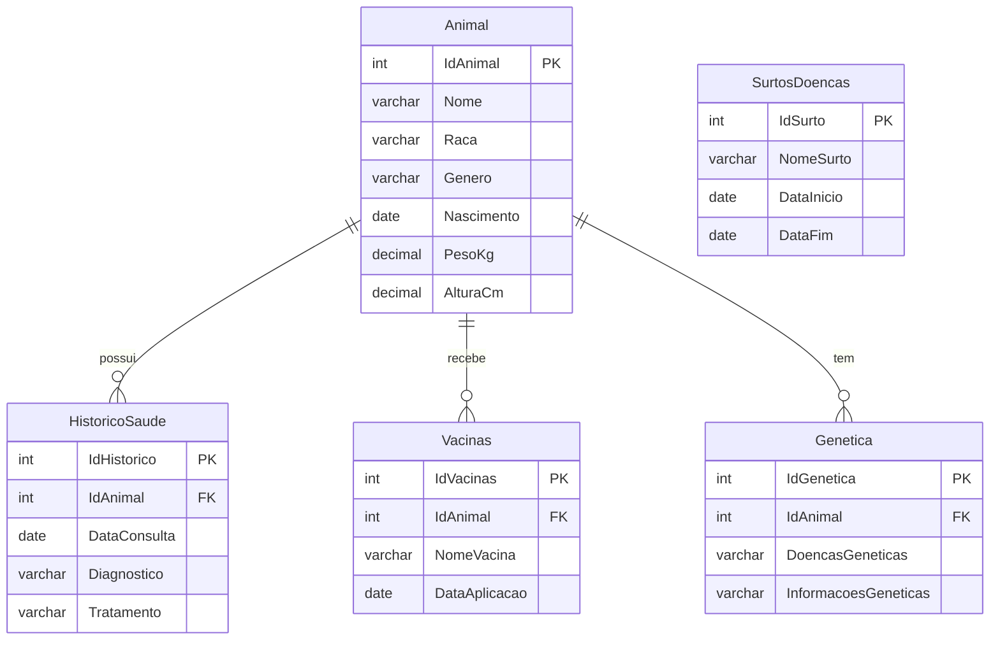

# SaudeAnimal

Banco de dados e back-end em Java para o controle da saúde de animais: cadastro, histórico de consultas, vacinas, informações genéticas e surtos de doenças.

Foi o meu primeiro projeto na área de TI. A versão original tinha telas em Java Swing (JFrame). Nessa versão deixei apenas o modelo de dados e a camada de acesso ao banco, reorganizados e corrigidos.

## Tecnologias

- Java 21
- MySQL 8 (compatível com MariaDB)
- JDBC com `PreparedStatement`
- Maven

## Modelo do banco



Ao excluir um animal, seu histórico, vacinas e informações genéticas são excluídos junto (`ON DELETE CASCADE`).

## Estrutura

```
sql/schema.sql                         criação do banco e das tabelas
src/main/java/com/saudeanimal/
    Main.java                          demonstração de ponta a ponta
    modelo/                            classes de domínio
    dao/                               acesso ao banco (um DAO por tabela)
```

Cada DAO implementa a interface genérica `DAO<T>` (`inserir`, `atualizar`, `excluir`, `buscarPorId`, `listarTodos`) e acrescenta consultas próprias, como `AnimalDAO.buscarPorNome` e `HistoricoSaudeDAO.listarPorAnimal`. Erros de banco são lançados como `DaoException`.

## Como executar

Pré-requisitos: JDK 21, Maven e um servidor MySQL (ou MariaDB) rodando.

1. Criar o banco:

```
mysql -u root -p < sql/schema.sql
```

2. Configurar a conexão com variáveis de ambiente. Se nenhuma for definida, os padrões são `jdbc:mysql://localhost:3306/saudeanimal`, usuário `root` e senha vazia.

| Variável | Padrão |
| --- | --- |
| `DB_URL` | `jdbc:mysql://localhost:3306/saudeanimal` |
| `DB_USER` | `root` |
| `DB_PASSWORD` | (vazia) |

No Windows (PowerShell): `$env:DB_PASSWORD="minha_senha"`. No Linux/macOS: `export DB_PASSWORD=minha_senha`.

3. Rodar a demonstração:

```
mvn compile exec:java
```

A `Main` cadastra um animal com histórico, vacina e informação genética, consulta os dados, atualiza o peso e, no final, remove tudo o que criou.

## Próximos passos

- Testes automatizados dos DAOs
- Pool de conexões
- Camada de serviço e API REST
