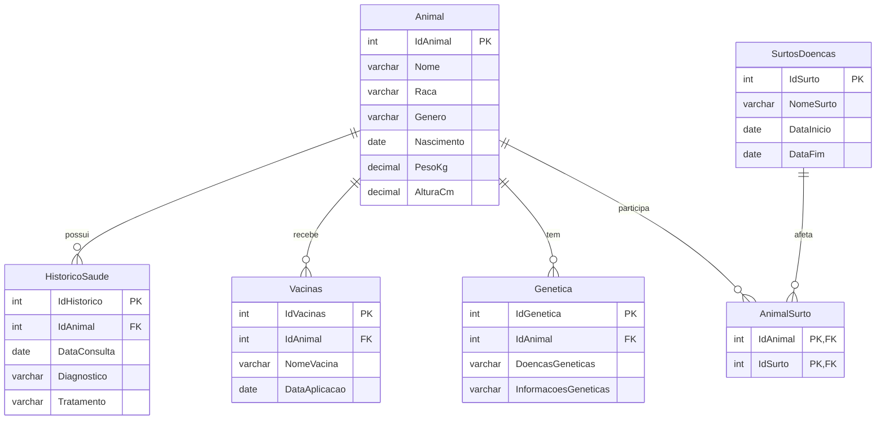

# SaudeAnimal

Banco de dados e back-end em Java para o controle da saúde de animais: cadastro, histórico de consultas, vacinas, informações genéticas e surtos de doenças, com um menu no console que oferece o CRUD completo de todas as tabelas.

Foi o meu primeiro projeto na área de TI. A versão original tinha telas em Java Swing (JFrame); nesta versão ficaram apenas o modelo de dados e a camada de acesso ao banco, reorganizados e corrigidos com o auxílio de IA (veja a seção "Uso de IA").

## Tecnologias

- Java 21
- MySQL 8 (compatível com MariaDB)
- JDBC com `PreparedStatement`
- Maven

## Modelo do banco



Um surto pode afetar vários animais e um animal pode passar por vários surtos (relação muitos-para-muitos), representada pela tabela de ligação `AnimalSurto`, cuja chave primária é composta por `IdAnimal` e `IdSurto`.

Ao excluir um animal, seu histórico, vacinas, informações genéticas e vínculos com surtos são excluídos junto. Ao excluir um surto, apenas os vínculos dele são removidos, e os animais permanecem (`ON DELETE CASCADE`).

## Estrutura

```
sql/schema.sql                         criação do banco e das tabelas
src/main/java/com/saudeanimal/
    Main.java                          ponto de entrada: abre o menu no console
    Demonstracao.java                  roteiro automático de ponta a ponta (cadastra, consulta, atualiza e exclui)
    modelo/                            classes de domínio
    dao/                               acesso ao banco (um DAO por tabela)
    menu/                              menus do console e leitura validada de dados
```

Cada DAO implementa a interface genérica `DAO<T>` (`inserir`, `atualizar`, `excluir`, `buscarPorId`, `listarTodos`) e acrescenta consultas próprias, como `AnimalDAO.buscarPorNome` e `HistoricoSaudeDAO.listarPorAnimal`. Erros de banco são lançados como `DaoException`.

Os menus seguem o mesmo padrão: a classe abstrata `MenuCrud<T>` contém o fluxo comum (cadastrar, listar, buscar, atualizar e excluir), e cada tela (`MenuAnimal`, `MenuVacina` etc.) informa apenas os campos e as opções extras da sua tabela.

## Como executar

Pré-requisitos: JDK 21, Maven e um servidor MySQL (ou MariaDB) rodando.

1. Criar o banco:

```
mysql -u root -p < sql/schema.sql
```

2. Configurar a conexão com variáveis de ambiente. Se nenhuma for definida, os padrões são `jdbc:mysql://localhost:3306/saudeanimal`, usuário `root` e senha vazia.

| Variável | Padrão |
| --- | --- |
| `DB_URL` | `jdbc:mysql://localhost:3306/saudeanimal` |
| `DB_USER` | `root` |
| `DB_PASSWORD` | (vazia) |

No Windows (PowerShell): `$env:DB_PASSWORD="minha_senha"`. No Linux/macOS: `export DB_PASSWORD=minha_senha`.

3. Rodar o programa:

```
mvn compile exec:java
```

Também é possível executar a classe `Main` direto pela IDE (IntelliJ, NetBeans, Eclipse).

## Usando o menu

```
=== SAÚDE ANIMAL ===
1 - Animais
2 - Histórico de saúde
3 - Vacinas
4 - Genética
5 - Surtos de doenças
0 - Sair
```

Cada opção abre um submenu com as mesmas operações:

| Opção | O que faz |
| --- | --- |
| 1 - Cadastrar | Pede os dados campo a campo |
| 2 - Listar todos | Mostra todos os registros |
| 3 - Buscar por ID | Mostra um registro |
| 4 - Atualizar | Mostra o valor atual de cada campo; Enter mantém e `-` limpa um campo opcional |
| 5 - Excluir | Pede confirmação antes de apagar |

Algumas telas têm opções extras:

- **Animais:** buscar por nome e listar os surtos do animal.
- **Histórico, vacinas e genética:** listar por animal (e, na genética, buscar por doença).
- **Surtos:** vincular e desvincular animais, e listar os animais de um surto. Cada surto mostra quantos animais foram afetados.

Detalhes:

- Datas são digitadas no formato `dd/mm/aaaa`, e decimais aceitam vírgula ou ponto (`28,5`).
- Histórico, vacinas e genética exigem escolher um animal já cadastrado.
- Entradas inválidas (data inexistente, texto longo demais, número negativo) são recusadas e a pergunta se repete.
- Se o banco estiver desligado ou a senha estiver errada, o programa avisa e encerra sem travar.

Para ver tudo funcionando de uma vez, sem digitar nada, execute a classe `Demonstracao`. Ela cadastra um animal com histórico, vacina e informação genética, consulta os dados, atualiza o peso e remove tudo o que criou.

## Uso de IA

O projeto original, incluindo o banco de dados, foi desenvolvido por mim como meu primeiro projeto em TI. Esta versão foi refatorada com o auxílio de uma IA (Claude, da Anthropic), que ajudou a:

- remover a interface gráfica e reorganizar o código em modelo, acesso a dados e menu;
- corrigir erros nos DAOs e no script SQL;
- trocar datas e medidas armazenadas como texto por tipos adequados (`DATE` e `DECIMAL`);
- criar o menu de console com o CRUD completo, a ligação entre animais e surtos e este README.

## Próximos passos

- Testes automatizados dos DAOs
- Pool de conexões
- Camada de serviço e API REST
